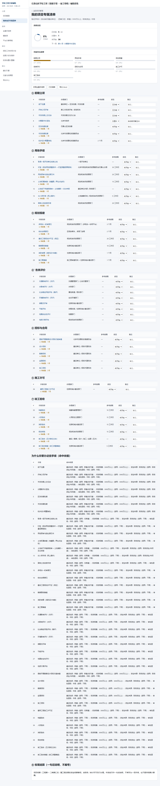

# 石景山区学校工程「前期手续 → 竣工验收」辅助系统

面向学校新建工程报建人员的**本地单页工具**：把 40 项前期手续、35 个模板文件、27 条退回原因、招标排期与投资估算装进一个网页。**双击 `index.html` 即开**，不联网、不安装、数据不出本机。


| 指标 | 数值 |
|---|---|
| 手续 | 40 项（7 个业务板块 + 1 项收尾说明） |
| 模板 | 35 个文件，按业务类别挂靠到具体手续 |
| 页面 | 14 个主页面 + 手续详情子页 |
| 代码 | 约 8,100 行（JS + CSS） |
| 测试 | 565 项断言，`node --test` 全绿 |
| 第三方依赖 | **0**：无 npm、无 CDN、无构建步骤 |

## 三个设计取舍

1. **`file://` 双击直开**。报建人员电脑上未必有 Node、未必能联网、更不可能配环境。因此放弃 ES Module、`fetch` 读本地文件和一切打包工具，全部用 UMD 双端写法兼容浏览器与 Node。
2. **零第三方依赖**。Word / PPTX / CSV / ZIP / 流程图导出全部手写：ZIP 用 STORE + CRC32 自拼，PPTX 由 15 个 OOXML 部件组装，Word 走保守 HTML。代价是要自己保证格式合法，收益是十年后这个仓库依然能跑。
3. **数据只存在本机浏览器**。IndexedDB → localStorage → 内存三级降级，每一级都有明确提示（黄条 / 红条）。没有任何服务端，也没有上报。

## 界面




更多截图见 [`docs/`](docs/)：全量手续库、手续详情、模板库、材料清单、招标计划、进度与估算、导出中心等 11 张。

## 30 秒上手

```bash
git clone https://github.com/Messi-1001/shijingshan-project-app.git
cd shijingshan-project-app
# 然后双击 index.html（Chrome / Edge）
```

无需 npm install，无需启动服务。详细功能导览见下方「一、使用说明」。

---

## 一、使用说明（面向使用者）

### 怎么打开
双击 `index.html`，用 Chrome 或 Edge 打开。不需要联网、不需要安装任何东西。
建议固定到浏览器书签，下次一键打开。

### 页面导览（左侧导航 14 个页面）

| 页面 | 用途 |
|---|---|
| 今日建议 | 系统给你的「下一步做什么」。打开就落在这里，有事先说事。 |
| 项目管理 | 新建/管理学校项目，一个项目一份专属清单。 |
| 我的项目专属清单 | 本项目要办的 37 项手续，可勾选、可标记办理中/已办结、可导出。 |
| 全量手续库 | 全部 40 项登记手续（含 3 项预留），按七个板块查看，点进去看依据与材料。 |
| 模板库 | 35 个模板文件，可复制、可导出 Word。 |
| 材料清单 | 每项手续要交哪些材料，可一键汇总、打印。 |
| 平台办事导航 | 两个申报平台的办理步骤，入口可点。 |
| 退回原因库 | 27 条常见退回原因与对应的整改动作。 |
| 招标工作时间计划 | 设计/勘察/监理/施工四类招标的时间轴，以及施工招标方式建议。 |
| 进度计划与倒排 | 正排或倒排的排期，带甘特图和关键路径。 |
| 投资估算计算器 | 两页纸投资估算表，可导出 Word。 |
| 数据管理 | 备份与恢复。 |
| 方案与效果图 | 两版概念方案的对比。 |
| 导出中心 | 所有导出都在这里。 |

另有顶栏全局搜索（手续/模板/退回原因/平台混合检索）与手续详情子页。

### 数据存在哪
**只存在你自己电脑的浏览器里**，不上传、不联网。清除浏览器数据、换浏览器、用无痕模式，都会导致录入内容丢失（此时页面顶部会出现黄条或红条提醒，红条状态请立即导出备份）。

### 重要：定期备份
每次录入了一批状态后，到「数据管理」页点「导出全部数据」，会下载一个 `.json` 文件。这个文件就是你全部的工作成果。**重要节点务必导一次。**恢复：同页选择该 `.json` 文件点「导入」。

### 导出都是什么格式
- Word（`.doc`）：可直接用 WPS/Word 打开、编辑、打印。
- PPT（`.pptx`）：真正的 PowerPoint 文件。如果打不开，用「工作汇报（HTML）」并在浏览器里打印为 PDF。
- CSV（`.csv`）：Excel 可直接打开。
- 流程图：优先 PNG；若浏览器限制，会自动改为 SVG，用浏览器打开后可另存或打印为 PDF。

### 常见问题
- **打开是空白页？** 确认打开的是 `index.html`，且 `js/`、`css/` 文件夹都在同一目录下。
- **数据没了？** 如果之前导出过 `.json` 备份，到「数据管理」页导入即可恢复。没导出过则无法找回。
- **效果图显示为占位图？** 把两张鸟瞰图命名为 `scheme-a.jpg`、`scheme-b.jpg` 放进 `assets/` 目录。
- **打印时表格被切断？** 打印设置里缩放选「默认」或「适合页面」，不要选自定义比例。
- **顶部出现黄色/红色横条？** 黄条=浏览器降级了存储方式，功能照常；红条=数据只能存在内存里、刷新会丢，请立即到「数据管理」导出备份。

---

## 二、开发者说明（面向开发/答辩）

### 交付形态（硬约束）
**`file://` 协议双击运行**，因此：

| 禁止 | 原因 |
|---|---|
| ES Module（`type="module"`） | `file://` 下会因 CORS 直接失败 |
| `fetch` / `XMLHttpRequest` 读本地文件 | `file://` 下被安全策略拦截 |
| CDN、Service Worker | 必须离线可用；SW 在 `file://` 下不可用 |
| 任何构建步骤（webpack/vite/rollup） | 交付物必须能直接双击打开 |

### 怎么同时做到「无构建」和「可测试」
所有 `js/` 下的模块用 **UMD 双端模式**：浏览器里挂 `window.SJSQ.*`，Node 里可 `require()`。
于是页面不需要打包，而 `js/logic/` 下的纯函数逻辑可以在 Node 里跑单测。

```js
(function (root, factory) {
  if (typeof module === 'object' && module.exports) module.exports = factory(require('./dep.js'));
  else { root.SJSQ = root.SJSQ || {}; root.SJSQ.logic = root.SJSQ.logic || {};
         root.SJSQ.logic.x = factory(root.SJSQ.logic.dep); }
})(typeof self !== 'undefined' ? self : this, function (dep) { /* ... */ });
```

### 目录结构
```
3代码实施/
├── index.html
├── css/        tokens / base / layout / components / print / platform / scheme
├── assets/     scheme-a.jpg, scheme-b.jpg, placeholder.svg
├── js/
│   ├── core/   ns, util, dom, store, idb, state, router
│   ├── data/   schema, procedures-01..07（七个板块）, procedures-index, templates,
│   │           guidance, conditions, platforms, reject-reasons, schemes
│   ├── logic/  graph, filter, progress, exporters, tender, schedule, estimate,
│   │           advice, search, backup, zip, pptx, flow, materials, render-template
│   └── views/  ui, shell, main 及各页面 v-*.js
├── tests/      node --test 运行，零 npm 依赖
├── scripts/    自检脚本（perf-measure 等）
└── docs/       验收记录、无头浏览器截图与实测结果
```

### 怎么跑测试
```bash
cd "D:/4workbuddy工作空间/2毕业设计/3代码实施"
"C:/Users/10304/.workbuddy/binaries/node/versions/22.12.0/node.exe" --test
```
> 不要写 `--test tests/`（Windows 下 Node 22 会把 `tests` 当模块 require 报错）；单文件用 `--test tests/xxx.test.js`。
> 只用 Node 内置 `node:test` + `node:assert/strict`，**没有任何 npm 依赖**。

### 技术难点
1. **零依赖 PPTX**：手写 ZIP（STORE + CRC32）与 OOXML（15 个部件）。已用 Python `zipfile` 与 `python-pptx` 做过结构验证。
2. **零依赖 Word**：`.doc` 扩展名 + `application/msword` + 保守 HTML（`border`/`cellspacing` 属性，不用 flex/grid）。
3. **日期运算**：`addDays` 用 `Date.UTC`，避免本地时区/夏令时导致差一天。
4. **数据即 JS**：40 项手续写成注册脚本写入 `SJSQ.rawData`，规避 `file://` 不能 `fetch` 的限制。
5. **三级存储降级**：IndexedDB → localStorage → 内存，每级都有明确文案（黄条/红条）。
6. **流程图图片导出降级**：`file://` 下 canvas 可能被污染，PNG 失败自动改导出 SVG。

### 已知限制
- 存量模板多为图片型 PDF（无可选中文字），内容级识别靠人工复核。
- 规则引擎本期不启用筛选 UI：四维取值固定，过滤结果恒等于全量清单（用测试锁死该预期）。
- 只覆盖**新建**工程；改扩建 / 装修改造需另补「城市更新」路径（`safetynet` 已能识别并提示）。
- 效果图为**概念示意**，不是设计成果。
- 项目资料位于 `D:\2工作\`，含真实企业名与个人信息，**未复制、未挂库**。

---

## 三、各阶段验收记录（存档）

### 阶段二验收记录（2026-10-05）
- [x] 全量手续库出现 ①→⑦ 共 40 行，⑤ 只有 1 行（集成测试 + 无头浏览器核对）
- [x] 搜索"划拨"命中 yd-7；搜索"副市长"命中 lx-4（检索字段含名称/部门/依据/说明）
- [x] ② 用地手续无"建设用地规划许可证"（该表在 guidance.EXCLUDED 备忘）
- [x] ① 第 4 项页面底部「办完本项之后」指向第 5 项（A→B 严格先后）
- [x] ⑦ 第 39 项前置列出 35/36/37/38 四项（并联汇合）
- [x] ⑧ 收尾结算只在库页底部作为一句话说明出现，未占编号
- 核对方式：`tests/integration-phase2.test.js`（10 例）+ verify-phase2.js（截图 `docs/verify-3-全量库.png`、`docs/verify-4-详情页.png`）
- 附带修正：手续行增加「串联 / 可并联」标注（数据 parallel 字段 + `graph.parallelPeers`）；v-detail 空态文案笔误修正

### 阶段三验收记录（2026-10-05）
- [x] 清单页 40 行，进度环随勾选变化（集成测试锁定 40 项 + 无头浏览器核对 done/doing 计数联动）
- [x] 改一项状态为「已办结」后，"下一项"自动跳转（`progress.nextUp` 纯函数测试 + 页面刷新后重绘验证）
- [x] 备注输入后刷新仍保留（IndexedDB 持久化 + 无头浏览器 F5 核对）
- [x] 导出 Word 的 download 事件已自动核对；WPS/Office 真机打开待阶段七验证
- [x] 各板块完成率看板随状态变化（`buildBoard` 三态测试 + 页面渲染核对）
- [x] 控制台调用 buildSafetyNet 传"装修改造"时，unhandled 含 sg-1 且原因含"城市更新"
- 核对方式：`tests/integration-phase3.test.js`（6 例）+ verify-phase3.js（截图 `docs/verify-5-专属清单.png`）

### 阶段四验收记录（2026-10-05）
- [x] 模板索引 35 条、零错误、挂靠手续全部存在；分类 2/6/6/2/19
- [x] 扫描件条目「复制内容 / 复制待填字段」置灰，悬停提示「请下载后手工填写」
- [x] 详情页 ⑥ 关联模板：有挂接的显示模板卡片，无挂接的显示空态
- [x] 模板库可搜索、可复制、可导 Word
- [x] 材料清单页概览数字相符（75 条 → 合并 69 条、142 份、37 项手续），按提供方分组 7 组
- [x] 自定义模板：新增入库、刷新后仍在；「打开文件」置灰并提示
- [x] 附带修复：自定义模板 id 派生保留中文并加 Date.now 后缀（含回归测试）
- 核对方式：`tests/integration-phase4.test.js`（10 例）+ verify-phase4.js（22/22，截图 `docs/verify-6-模板库.png`、`docs/verify-7-材料清单.png`）

### 阶段七验收记录（2026-10-05）
- [x] spec v1.3 第 10 章 **9 条验收标准逐条核对完成**，判定与证据见 `docs/验收记录.md`
- [x] 体积预算护栏 `tests/budget.test.js`（9 断言）：JS/CSS/HTML/图片/资源总计均在预算内
- [x] 性能护栏 `tests/perf.test.js`（Node 冒烟）+ `scripts/perf-measure.js`（无头浏览器实测）：首屏/清单首渲染/搜索均值达标（`docs/perf-check/perf-results.json`）
- 附带清理：advice.js risk 规则只数专属命中、预留项文案对齐、search hash 与 router.buildHash 同构、平台菜单文案、advice.js 死参数
